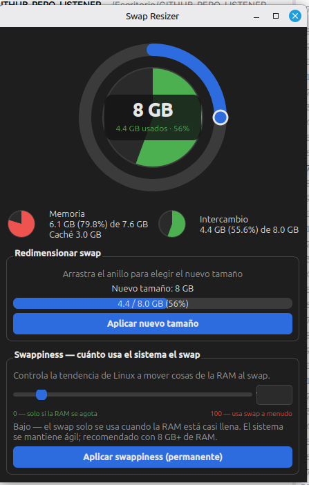

# Swap Resizer

Aplicación de escritorio en **PyQt6** para monitorizar y redimensionar el
swapfile (`/swapfile`) en Linux, con estilo inspirado en el Monitor del
Sistema de GNOME.



## Características

- **Anillo interactivo arrastrable** — arrastra sobre el círculo para elegir
  el nuevo tamaño del swap (escala 1–32 GB).
- **Quesito de uso (estilo GNOME)** — el interior del anillo muestra el % de
  swap usado con relleno de color (verde <60 %, naranja <85 %, rojo ≥85 %).
- **Chip central** — tamaño elegido y GB usados actuales.
- **Panel de recursos** — mini-quesitos para `Memoria` (usada, % y caché)
  e `Intercambio` (usado y %), actualizados cada 2 s.
- **Barra de progreso** — espejo del uso actual del swap.
- **Control de swappiness** — slider con etiquetas y descripción dinámica;
  persistente vía `/etc/sysctl.d/99-swappiness.conf`.
- **Elevación gráfica** — operaciones privilegiadas con `pkexec`
  (no hace falta lanzar la app como root).

## Requisitos

- Python 3.10+
- Swap como archivo en `/swapfile` (entrada en `/etc/fstab`)
- `pkexec` (polkit)
- `libxcb-cursor0` — necesaria para Qt ≥ 6.5 en X11:

  ```bash
  sudo apt install libxcb-cursor0
  ```

## Instalación

```bash
cd swap-resizer
python3 -m venv .venv
source .venv/bin/activate
pip install -r requirements.txt
```

En Ubuntu/Debian también puedes usar el paquete del sistema:

```bash
sudo apt install python3-pyqt6
```

## Uso

```bash
.venv/bin/python swap_resizer.py
```

### Redimensionar el swap

1. Arrastra el anillo hasta el tamaño deseado (1–32 GB).
2. Pulsa **Aplicar nuevo tamaño**.
3. Confirma e introduce tu contraseña cuando la pida `pkexec`.

Internamente ejecuta `apply_swap.sh` (`swapoff` → `fallocate`/`dd` →
`chmod 600` → `mkswap` → `swapon`).

### Ajustar el swappiness

Mueve el slider (0–100) y pulsa **Aplicar swappiness (permanente)**.
El cambio se aplica al instante y sobrevive a reinicios.

## Notas

- Al redimensionar, el swap se desactiva temporalmente; si está muy lleno
  y la RAM justa, libera memoria antes de aplicar.
- El tamaño persiste tras reinicio gracias a `/etc/fstab`.
- Si `fallocate` falla (p. ej. btrfs), el script usa `dd` automáticamente.
- Si Qt no arranca con `xcb-cursor0 ... is needed`, instala
  `libxcb-cursor0` (ver Requisitos).
